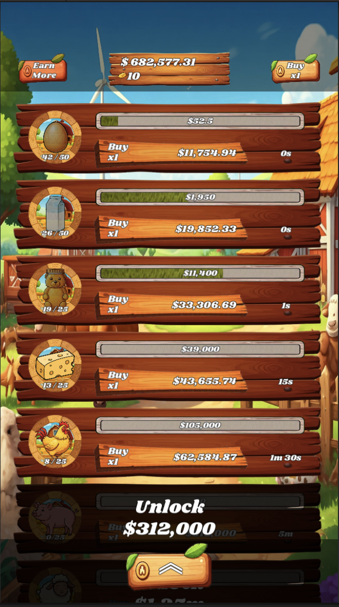
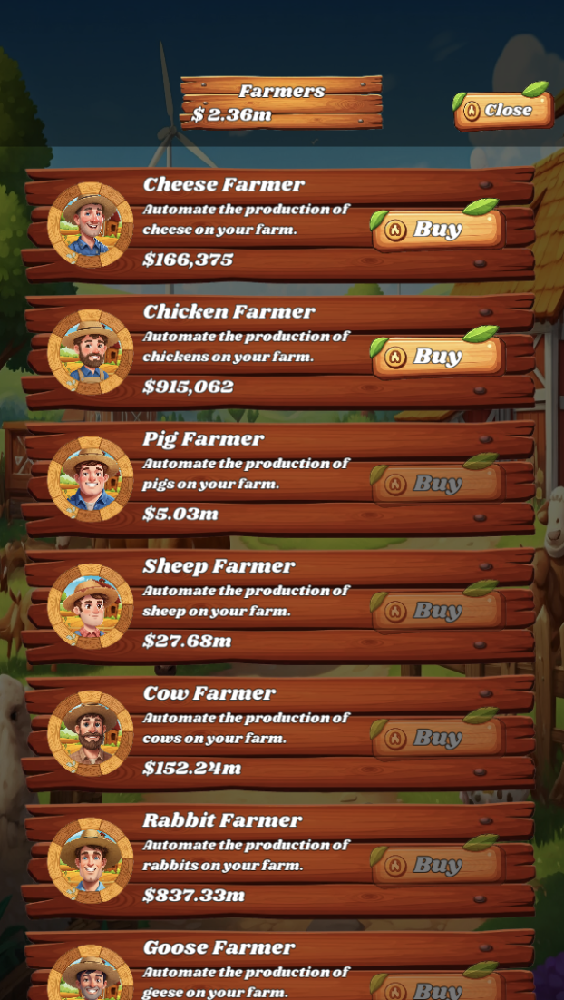

# Barnyard Billionaire

A farm-themed idle tycoon game for iOS and Android, built with Unity and C#. It comes with a PHP/MySQL
backend for the leaderboard and a React marketing site.

Start with a single egg farm and build an empire of ten farms. Hire farmers to automate production,
prestige for gold and permanent bonuses, and climb a weekly leaderboard that shared 50% of game revenue
with players (paid in SOL to their Solana wallets).

| | |
|---|---|
|  |  |

## Repository layout

```
game/      Unity 2022.3 project (Assets, Packages, ProjectSettings)
api/       PHP endpoints for scores, the leaderboard and request signing
website/   React + TypeScript + Vite + Tailwind marketing site with a live leaderboard
```

## Game

- **10 farms:** Eggs, Milk, Honey, Cheese, Chickens, Pigs, Sheep, Cows, Rabbits and Geese. Production
  times range from 1 second to 22 hours, and every 25 levels a farm's production time is halved.
- **30 farmers** automate collection and multiply earnings.
- **Prestige** resets the farm in exchange for gold and a permanent earnings bonus. Gold buys 12 upgrades
  that carry over between runs.
- **Offline earnings** are measured against server time, so they can't be cheated by changing the device clock.
- **`BigDecimal` economy:** costs and earnings pass 10²⁴ without losing precision.
- **Monetisation:** LevelPlay mediation (rewarded ads for 2× production and 2× offline earnings,
  interstitials) and a "remove ads" in-app purchase through Unity IAP.
- **Leaderboard:** Solana wallet validation, signed score submissions, a 24-hour cooldown between
  submissions, a 14-day lock on changing wallet, and referral codes.

Key scripts are in `game/Assets/Scripts/`:

| Folder | Contents |
|---|---|
| `Game/` | Economy, prestige, upgrades, farmers, offline earnings, saving, score submission |
| `Stages/` | One controller per farm |
| `Ads/` | LevelPlay rewarded, interstitial and offerwall ads, plus the remove-ads purchase |

### Running the project

1. Open `game/` in **Unity 2022.3.62f1**.
2. Copy `Assets/Scripts/Game/Secrets.cs.example` to `Secrets.cs` and set `SERVER_SECRET_KEY`. It must
   match `SECRET_KEY` on the server. `Secrets.cs` is git-ignored.
3. Open `Assets/Scenes/main.unity` and press Play.

### WebGL build

The browser demo is built from the same project. WebGL-only code paths (`#if UNITY_WEBGL`) use the
system clock instead of the server time endpoint, skip the backend calls and disable ads, because
LevelPlay and `HttpClient` aren't supported in WebGL.

## API

A small PHP API backed by MySQL (`api/`):

| File | Purpose |
|---|---|
| `config.php` | Reads database credentials and `SECRET_KEY` from environment variables |
| `connect.php` | MySQL connection |
| `functions.php` | Leaderboard query, score saving (prepared statements) and HMAC-SHA256 token verification |
| `get_leaderboard.php` | Returns the leaderboard as JSON |
| `save_score.php` | Validates and stores a signed score submission |

Requests from the game are signed with HMAC-SHA256 over the JSON payload (`dataManager.GenerateToken`)
and checked server-side with `hash_equals`.

> Because the signing key ships inside the game build, it can be extracted. Signing makes cheating harder
> but doesn't prevent it; server-side checks on how plausible a score is would be the next step.

## Website

```bash
cd website
npm install
npm run dev
```

## Status

The backend and barnyardbillionaire.com are no longer online, so the leaderboard and reward features are
inactive. The browser demo runs fully offline.
